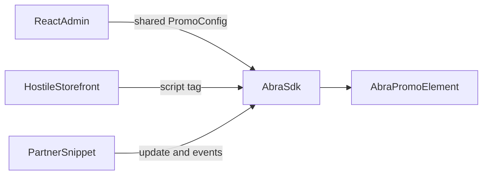

# Storefront Promotion SDK

Senior front-end exercise modeled on client-side work at Abra: a promotional widget that runs on a merchant storefront, a small SDK other developers can build on, and the admin screen that configures it.

This repository is the starter. It boots, mounts a placeholder, and leaves the product behavior for you to implement.

## Frameworks and tools

- TypeScript
- Plain Custom Elements and Shadow DOM (no Lit)
- React 19 for the admin only
- Vite
- Vitest with happy-dom

The storefront path must not depend on React. Do not add a UI kit. Widget styles stay inside the shadow root. Admin styles stay in the admin bundle.

## Goal

Ship one promotional widget that a hostile storefront can load without React, a small typed SDK other developers can build on, and a React admin that configures it and previews the real element.

## Estimated time

4–6 hours. Stop at the cap and write down what you would do next.

## Description

A merchant wants a cart-aware gift banner: “You are $X away from a free tote,” an apply-code action, and dismiss.

Partners push cart subtotal changes and listen for shopper actions. The admin edits the threshold, reward, promo code, and colors, and the preview uses the same `<abra-promo>` element as the storefront. Global CSS on the demo page must not restyle the widget.



The demo page already loads aggressive global CSS (`*`, `button`, and `p`). That page stands in for a theme you do not control.

## Setup and run

1. Install Node.js 20 or newer.
2. Open a terminal in this folder.
3. Check the runtime:

```powershell
node -v
```

4. Install dependencies:

```powershell
npm install
```

5. Run the sanity test:

```powershell
npm test
```

6. Start the admin. Vite prints a local URL. Open `/` if it does not open on its own.

```powershell
npm run dev
```

7. On that same origin, open `/demo/storefront.html` for the storefront. `npm run demo` starts the same server and opens the storefront URL directly. Run only one of `dev` or `demo` at a time. They share a port.
8. Build the admin, the demo page, and the SDK library (`dist/` and `dist/sdk/`):

```powershell
npm run build
```

The cart slider on the storefront updates the page readout and calls `Abra.update`. The placeholder widget ignores that call until you implement it.

## What is already here

- `src/sdk/types.ts` — shared `PromoConfig` and a sample gift (`$75`, free tote, code `GIFT75`).
- `src/sdk/progress.ts` — `getProgress`, still a stub.
- `src/sdk/abra-promo.ts` — `<abra-promo>` with an open shadow root and a “not implemented” message.
- `src/sdk/index.ts` — placeholder `Abra.init` / `update` / `destroy` / `on` / `off` so both pages boot. Replace this with the API you design, and update the admin and demo call sites if the shape changes.
- `src/admin/App.tsx` — config form bound to React state. The preview remounts the placeholder. Validation is not implemented.
- `demo/storefront.html` — hostile storefront wired to the stub.
- `examples/partner.js` — commented skeleton.
- `tests/progress.test.ts` — one passing shape check. The cases below are not written yet, so the API design stays yours.

## Build these

### Web component

- Keep `<abra-promo>` as an open-shadow custom element.
- Render how far the shopper is from the reward, using the shared config and the cart subtotal. When the subtotal reaches the threshold, say the reward is unlocked.
- Updating the subtotal changes that message on the existing element. Do not replace the node.
- Apply and Dismiss are buttons that work with the keyboard.
- Apply emits `abra:apply` and includes the promo code. Dismiss emits `abra:dismiss` and hides the widget.
- Both events are observable on the element itself. They have to cross the shadow boundary.
- Host-page rules for `button` and `p` must not restyle the widget.

### Partner SDK

- Publish a versioned, typed API a host page can call without React.
- The starter methods are `init`, `update`, `destroy`, `on`, and `off`. Keep them, or document a different shape and update the admin and the demo.
- `update` changes the cart subtotal in place.
- `on` / `off` subscribe to the shopper events above.
- In the README section below, document every public method, the event payloads, and the versioning rule: what you consider a breaking change.

### Admin

- Keep a single `PromoConfig` type shared with the SDK.
- Validate the threshold and the promo code, and show the errors in the form.
- The live preview must be the real `<abra-promo>` element, updating in place as the form or the preview subtotal changes.

### Tests to add

Do not weaken the existing shape test. Add:

- Progress: subtotal below the threshold reports the positive amount still needed and `completed: false`.
- Progress: subtotal equal to the threshold reports `remaining: 0` and `completed: true`.
- Progress: subtotal above the threshold reports `remaining: 0` and `completed: true`.
- Progress: document how you handle a negative subtotal or threshold, and test that choice.
- Component: activating Apply dispatches `abra:apply` with the promo code, observable on the element.
- Component: activating Dismiss dispatches `abra:dismiss`, observable on the element.
- Component: `update` changes the rendered message without creating a second element.
- Component: host-page `button` and `p` rules do not restyle elements inside the shadow root.

### Write-ups

- Fill in `PERFORMANCE.md`: layout shift, main-thread work, and CSS/JS leakage.
- Replace the comments in `examples/partner.js` with a snippet a partner could paste.
- Fill in the public API section below.

Optional if time remains: remember dismiss for the rest of the browser session with `sessionStorage`.

## Public API

You write this. Include the version, each method, the event names and payloads, and what counts as a breaking change.

## Tradeoffs

If you stop at the time cap, note what you left unfinished and what you would do next.
